<div align="center">

# half-fixed

**Your bug was fixed. Just not everywhere.**

[](https://github.com/heyzainali/half-fixed/actions/workflows/ci.yml)
[](LICENSE)
[](https://agentskills.io)
[](https://docs.anthropic.com/en/docs/claude-code)
[](https://developers.openai.com/codex)
[](package.json)



</div>

Most codebases have siblings: provider adapters, database drivers, cache stores, payment gateways, platform ports. Each one does the same job its own way. When a bug turns up in one of them, someone fixes that one and moves on. The siblings often have the same code and the same bug, and nobody notices until a user hits it.

half-fixed reads your git history and finds those gaps. It's a fast, offline scanner plus two agent skills. One works out which findings are real bugs and fixes them with tests. The other writes the pull request the way the project's maintainers expect.

## Bugs it has found

| Project | The fix that landed | The sibling that missed it | Pull request |
|---|---|---|---|
| [prism-php/prism](https://github.com/prism-php/prism) | DeepSeek and OpenRouter stopped failing on tools with no parameters ([`9447c71`](https://github.com/prism-php/prism/commit/9447c71d8697950ff1005f2409b95c99afcdcf84)) | Groq, Mistral, xAI and Z still sent `"properties": []`, which their APIs reject | [#1038](https://github.com/prism-php/prism/pull/1038) |
| [BerriAI/litellm](https://github.com/BerriAI/litellm) | `disable_custom_api_keys` started honouring `config.yaml` ([#42437](https://github.com/BerriAI/litellm/pull/42437)) | `scope_user_search_to_org` still ignored `config.yaml`, so any logged-in user could list every user while the settings page said they couldn't | [#44925](https://github.com/BerriAI/litellm/pull/44925) |
| [BerriAI/litellm](https://github.com/BerriAI/litellm) | Azure's passthrough started reading the value of `stream` ([`df6fb9e`](https://github.com/BerriAI/litellm/commit/df6fb9e5d95e97b7b207cd278d107e82b134fe45)) | vLLM's passthrough still only checked that the key existed, so `"stream": false` on the `/vllm` route crashed with a 500 | [#44936](https://github.com/BerriAI/litellm/pull/44936) |

Each one started as a single finding, like `hf-5505660` in the scan above. Found one yourself? Open a pull request that adds it to this table.

## How accurate is it?

Every high-confidence finding on litellm's main branch at [`b6d587d`](https://github.com/BerriAI/litellm/tree/b6d587d23e1c104340a905b45cb4027d7153a0ad) was checked against the original fix and the sibling's code:

| Verdict | Findings |
|---|---:|
| Real gap: the sibling still has the bug | 13 |
| Fixed another way, or no longer needed | 40 |
| Deliberately different | 12 |
| Unsure | 1 |

So about one in five was a real bug, in a heavily reviewed project with nearly 1,800 contributors. The other four in five are why half-fixed never patches anything on its own: in mature code, most differences between siblings are on purpose. The scanner turns thousands of commits into a short list. The skill makes your agent read each one and back every verdict with evidence.

It's fast enough to run on anything:

| Project | Commits read | Sibling groups | High-confidence findings | Time |
|---|---:|---:|---:|---:|
| [prism-php/prism](https://github.com/prism-php/prism) | 337 | 46 | 24 | 3 s |
| [laravel/framework](https://github.com/laravel/framework) | 1,960 | 90 | 8 | 6 s |
| [django/django](https://github.com/django/django) | 563 | 52 | 7 | 3 s |
| [rails/rails](https://github.com/rails/rails) | 1,569 | 60 | 3 | 5 s |
| [BerriAI/litellm](https://github.com/BerriAI/litellm) | 5,000 | 339 | 66 | 69 s |

**[The evidence page](docs/evidence/README.md)** has every revision, the raw output, and the verdicts with links to the exact lines, so you can check all of it.

## Quick start

**Claude Code** (type these in a session):

```text
/plugin marketplace add heyzainali/half-fixed
/plugin install half-fixed@half-fixed
```

**Codex:**

```bash
codex plugin marketplace add heyzainali/half-fixed
codex plugin add half-fixed@half-fixed
```

**Any other agent that reads `SKILL.md`** (Cursor, GitHub Copilot, Gemini CLI, OpenCode, and others):

```bash
npx skills add heyzainali/half-fixed
```

Then ask your agent: *"Find half-fixed bugs in this repo"*, or *"Did my last fix reach every provider?"*

**Just the CLI.** It needs Node 18 or newer and nothing else:

```bash
npx half-fixed scan
```

<details>
<summary><strong>Or let your agent install it</strong></summary>

Paste this into your coding agent:

```text
Install the half-fixed skills from https://github.com/heyzainali/half-fixed.

Work out which agent you are, then use the matching method. If a command fails or you can't run it, tell me the exact command to run myself.

- Claude Code: run `claude plugin marketplace add heyzainali/half-fixed`, then `claude plugin install half-fixed@half-fixed`. If the `claude` CLI isn't available, tell me to type `/plugin marketplace add heyzainali/half-fixed` and then `/plugin install half-fixed@half-fixed` in this session.
- Codex: run `codex plugin marketplace add heyzainali/half-fixed`, then `codex plugin add half-fixed@half-fixed`.
- Any other agent that supports SKILL.md: run `npx skills add heyzainali/half-fixed`. If that doesn't work, clone the repository to a temporary directory and copy both folders in its `skills/` directory into your skills directory.

Prefer a project install unless I asked for a global one. When you're done, tell me what you installed, where, and whether I need to restart you.
```

</details>

## How it works

1. **Find siblings.** Files whose paths differ in exactly one directory form a group, like `src/Providers/*/Maps/ToolMap.php`. So do files in one directory that share a name suffix, like `src/Cache/*Store.php`. Tests, vendored code, and build output are skipped.
2. **Replay history.** For every commit that changed only some members of a group, half-fixed takes the code the commit replaced, plus just enough surrounding lines to pin it down. A fix that wraps old code instead of deleting it still counts.
3. **Check the rest.** If another member still has that code, ignoring whitespace, and doesn't already have the new lines, it's reported as missing the change.
4. **Rank.** Fix commits rank above features and refactors. Commits about lint, types, or formatting don't count as fixes. A change that relies on names only the fixed file has, like a renamed local variable, ranks lower, because no sibling could take it as-is.

The only program it runs is `git`, and it never writes to your repository. There's no model, no network access, no telemetry, and no dependency to install.

## Reading a finding

```text
  hf-5505660  high  fixed in 2 of 10, still old in 4
    fixed    DeepSeek, OpenRouter 9447c71 2025-10-14 fix(DeepSeek|OpenRouter): Fix exceptions during tool conversion without parameters (#661)
    missing  Groq:21, Mistral:21, XAI:21, Z:21
    + ...$tool->hasParameters() ? [
    + ] : [],
```

- **`hf-5505660`** is a stable ID. Pass it to `half-fixed show` for the full old and new code and the file and line in every sibling, or use it in an exemption.
- **`high`, `medium`, `low`** is the confidence. `high` means a bug-fix commit replaced code that siblings still have, or several fix commits made the same addition. `medium` is a single fix that only added lines, or the same non-fix change made in several commits. `low` is a single feature or refactor commit. Any finding drops a level when no sibling could take the new code as-is (see `needs` below). The scan shows `high` by default.
- **`fixed in 2 of 10`** means the change reached 2 of the 10 members of the group. **`still old in 4`** means 4 members still have the old code. The other members differ too much to compare.
- **`missing  Groq:21`** is a sibling and the line where its old code starts.
- **`+` and `-` lines** preview what the fix changed. Here it only shows added lines, because `9447c71` wrapped the old block instead of replacing it.

In `show` and `--json` output, a sibling can also list **`needs`**: names the new code uses that the sibling's file doesn't have. A non-empty `needs` means the fix has to be adapted, not copied.

## The skills

| Skill | What it does | Try saying |
|---|---|---|
| **half-fixed** | Runs the scan, then triages every finding as `gap`, `intentional`, `handled-elsewhere`, `obsolete`, or `unsure`, with evidence for each. Fixes confirmed gaps test-first and records deliberate differences as exemptions. | *"Find half-fixed bugs in this repo"* |
| **house-style** | Learns a repository's conventions from its contributing guide, PR template, CI, and recently merged pull requests. Checks for duplicate PRs, scope creep, and AI-contribution policies, then drafts the commit and PR to match. Never pushes without your go-ahead. | *"Draft the PR for this fix in their style"* |

## Check your own branch

`--base` limits the scan to your branch's commits. It catches the moment you change two siblings and forget the third:

```bash
npx half-fixed scan --base origin/main --confidence low
```

Run on the branch behind prism-php/prism#1038, it flags DeepSeek and OpenAI as left out. That was deliberate, because both already omit `parameters` for tools without any, but it's exactly what a reviewer will ask about, so it belongs in the PR description.

In CI, the exit code is 1 when there are findings and 2 on an error:

```yaml
- uses: actions/checkout@v4
  with:
    fetch-depth: 0
- run: npx half-fixed scan --base origin/${{ github.base_ref }} --confidence low
```

## CLI

```text
half-fixed scan [path]        list changes made to some siblings but missing from others
half-fixed show <id> [path]   full detail for one finding
half-fixed groups [path]      list the sibling groups that will be compared

--rev <rev>          revision to check (default HEAD)
--base <rev>         only commits after this one
--since <date>       only read history after this date
--max-commits <n>    history depth (default 5000)
--min-members <n>    smallest sibling group to consider (default 3)
--group <text>       only groups whose pattern contains this text
--confidence <lvl>   lowest confidence to report: high (default), medium, low
--all                same as --confidence low
--json               machine-readable output
```

Exit codes: 0 when nothing is found, 1 when there are findings, 2 on an error.

## Configuration

Put a `.half-fixed.json` at the repository root to record deliberate differences and tune the scan:

```json
{
  "exempt": [
    { "id": "hf-ca17de4", "members": ["DeepSeek"], "reason": "DeepSeek omits parameters on purpose, see 9447c71" }
  ],
  "exclude": ["legacy/**", "django/conf/locale/**"],
  "minMembers": 3,
  "maxCommits": 5000
}
```

- **`exempt`** dismisses a finding, or only some of its members, with a reason. Dismissed findings are still counted in the output, so nothing disappears silently.
- **`exclude`** adds globs to skip on top of the defaults (tests, `vendor`, `node_modules`, build output).
- **`include`** replaces the default filter, which keeps source files in common languages, with your own globs.

## FAQ

**Does it use AI or send my code anywhere?**
The scanner doesn't. It runs `git` locally and prints text. The skills are instructions for the coding agent you already use, and they only decide what to do with the scanner's output.

**How noisy is it?**
About one high-confidence finding in five was a real bug in litellm, and the rest were deliberate or already handled (see [How accurate is it?](#how-accurate-is-it)). The skill is built around that. Things that differ on purpose, like locale files or backend feature flags, can be excluded or exempted once and they stay quiet.

**Which languages does it support?**
Matching works on lines with whitespace ignored, so it doesn't parse any language. By default it scans source files in about thirty languages, including PHP, Python, Ruby, JavaScript, TypeScript, Go, Java, Kotlin, Rust, C, C++, C#, Swift, and Elixir. For anything else, list your files with `include` in `.half-fixed.json`.

**Why didn't it find a gap I know about?**
Either the sibling's code was already different from the old code, even slightly, or the siblings aren't arranged by path in a way half-fixed recognises. See the limits below.

## Limits

- **It needs history.** In a shallow clone, run `git fetch --unshallow` first, or accept a shorter window.
- **It matches code exactly, apart from whitespace.** A sibling with the same bug written differently won't be found.
- **Siblings are found by path.** Implementations that live in unrelated places, or whose files are named after themselves in different directories (`mysql/mysql-compiler.js`, `pg/pg-compiler.js`), aren't compared.
- **Renaming a directory breaks the link** between older commits and the files as they are now.

## Contributing

You need [Bun](https://bun.sh), at the version pinned in `package.json`, and Node 18 or later:

```bash
bun install
bun run test
bun run half-fixed -- scan /path/to/repo
```

[CONTRIBUTING.md](CONTRIBUTING.md) covers the layout, the checks CI runs, and the rules for changing detection. Please read the [Code of Conduct](CODE_OF_CONDUCT.md), and report security issues as described in [SECURITY.md](SECURITY.md).

## License

[MIT](LICENSE)
